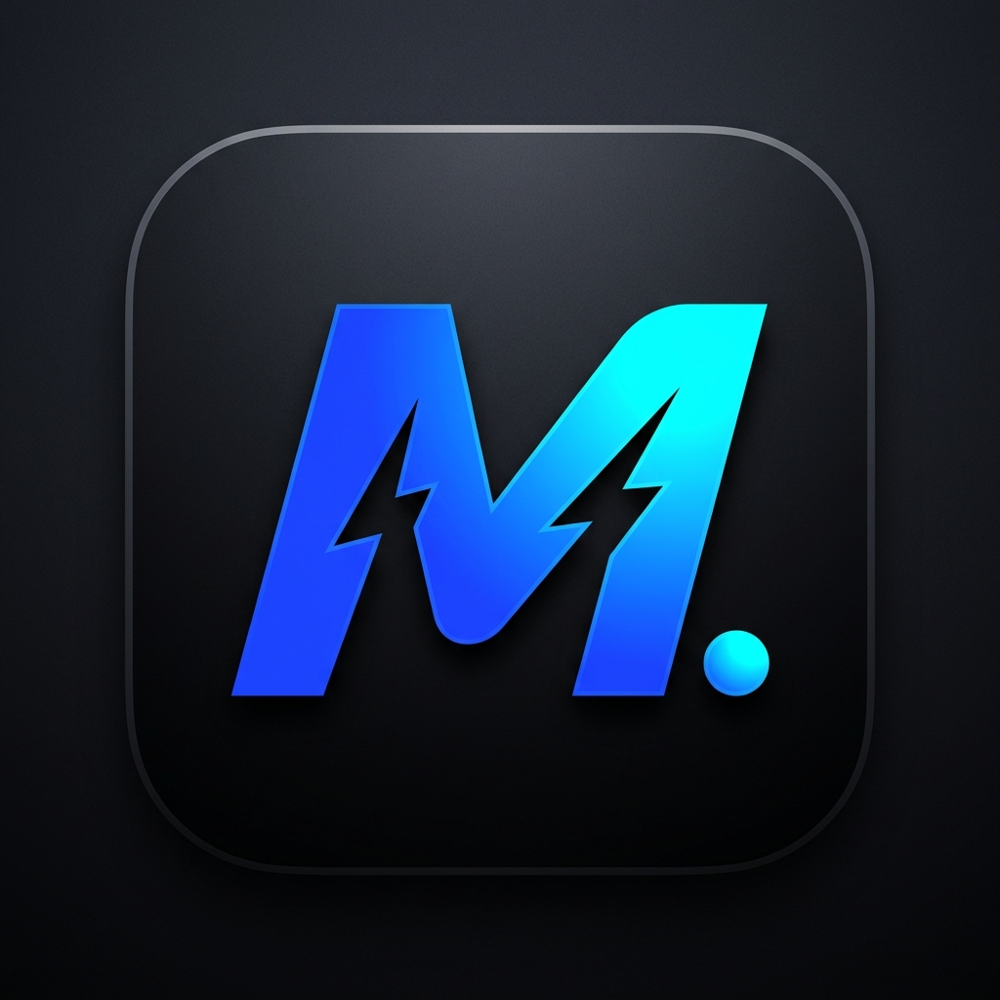

  

<h1 align="center">MSign</h1>

  <b>Trình ký ứng dụng & cài đặt IPA trực tiếp trên thiết bị iOS</b>

  
  
  

---

## Giới thiệu

**MSign** là công cụ ký mã số và cài đặt tệp tin IPA trực tiếp trên iPhone/iPad không cần máy tính. Ứng dụng kết hợp hiệu năng vượt trội của nhân ký mã nguồn mở với ngôn ngữ thiết kế **Liquid Glass** hiện đại, mang phong cách nhận diện Electric Blue đặc trưng.

### Điểm nổi bật
- ⚡ **Ký IPA siêu tốc on-device**: Tích hợp động cơ C++ `zsign` tối ưu hóa đa luồng, ký ứng dụng chỉ trong vài giây.
- 🎨 **Giao diện Liquid Glass**: Phong cách kính mờ (.ultraThinMaterial), viền gradient dạ quang và hiệu ứng thị giác mượt mà trên iOS 16+.
- 📦 **Tích hợp sẵn hơn 30 nguồn KhoIPA**: Đầy đủ các kho ứng dụng, game và tiện ích phổ biến, tự động kiểm tra trạng thái hoạt động của từng nguồn.
- 📲 **Cài đặt linh hoạt**: Hỗ trợ phương thức cài đặt qua máy chủ nội bộ (Bán cục bộ & Cục bộ hoàn toàn) tương thích tốt từ iOS 16 đến iOS 18.
- 💉 **Tùy biến & Chèn Tweak**: Hỗ trợ inject dylib, framework, thay đổi Bundle ID, chỉnh sửa Info.plist trực tiếp trước khi ký.
- 🔐 **Quản lý chứng chỉ đơn giản**: Nhập và lưu trữ chứng chỉ `.p12` và `.mobileprovision`, theo dõi hạn sử dụng theo thời gian thực.
- 🔄 **Cập nhật tự động**: Nhận thông báo và cập nhật phiên bản mới trực tiếp trong ứng dụng chỉ với 1 chạm.

---

## Cài đặt

Tải về bản dựng mới nhất tại mục [Releases](https://github.com/helloanhem07/MSign/releases/latest):

1. Tải tệp tin `msign1.1.ipa`.
2. Cài đặt thông qua TrollStore, ESign, Scarlet, AltStore hoặc Sideloadly.
3. Mở MSign, nhập chứng chỉ của bạn và bắt đầu ký ứng dụng.

---

## Đóng góp & Giấy phép

Dự án được phân phối dưới giấy phép **GNU General Public License v3.0**. Mọi đóng góp, báo lỗi hoặc yêu cầu tính năng mới đều được hoan nghênh tại mục [Issues](https://github.com/helloanhem07/MSign/issues).
